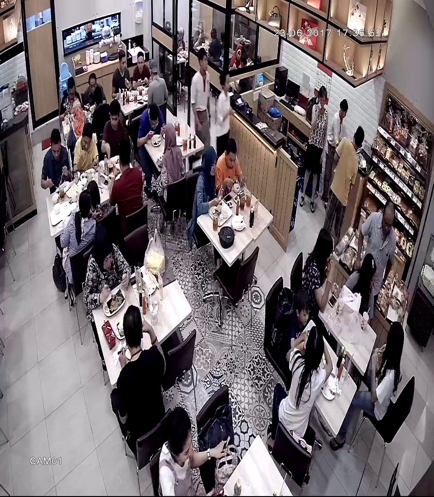
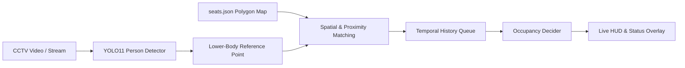

# Café Seat Occupancy Detection

[](https://www.python.org/)
[](https://docs.ultralytics.com/)
[](https://opencv.org/)
[](https://pytorch.org/)
[]()

> Real-time café seat occupancy and availability monitoring system using CCTV footage, YOLO11 person detection, custom polygon seat mapping, and temporal smoothing.

---



---

## Catatan & Disclaimer (Project Pembelajaran)

> *"Projek ini dibuat sebagai sarana eksplorasi dan pembelajaran Computer Vision & Deep Learning. Sistem ini masih jauh dari sempurna dan masih dalam tahap pengembangan aktif (Work in Progress).*  
> *Masih terdapat beberapa edge-cases (misal: oklusi antar pengunjung, kursi yang digeser, atau sudut pandang kamera ekstrem) yang terus dipelajari untuk ditingkatkan ke depannya. Masukan, saran, dan diskusi sangat terbuka!"*

---

## Latar Belakang (Overview)

Mengetahui ketersediaan kursi di kafe atau restoran secara *real-time* biasanya memerlukan sensor fisik (IoT) pada setiap bangku yang mahal dan rumit perawatannya. 

Proyek ini memanfaatkan kamera CCTV yang sudah ada dengan pendekatan Computer Vision berbasis software:
1. Mengidentifikasi posisi pengunjung menggunakan model **YOLO11 Nano**.
2. Memetakan area kursi tetap (*fixed seats*) secara interaktif menggunakan poligon.
3. Menghubungkan setiap orang ke kursi terdekat dengan skor bobot geometris (*person-to-seat association*).
4. Menerapkan **temporal state smoothing** untuk mencegah *flicker* (status berkedip-kedip) saat orang bergerak atau terhalang sejenak.

---

## Fitur Utama

- **Deteksi Orang Real-Time:** Menggunakan YOLO11n yang ringan dan cepat untuk deteksi kelas `person` (COCO class 0).
- **Interactive Seat Mapping Tool (`map_seats.py`):** Antarmuka visual untuk menandai poligon kursi secara manual pada frame CCTV, disimpan ke format `seats.json`.
- **Smart Association Algorithm (`occupancy.py`):**
  - Menggunakan titik referensi tubuh bagian bawah / pinggang (*lower-body reference*, ~65% tinggi bbox), bukan sekadar titik tengah atau kaki.
  - Perhitungan multi-faktor: *point-in-polygon containment*, jarak ke centroid/anchor, serta confidence model.
  - Penugasan 1-ke-1 (*one-to-one matching*) untuk mencegah satu orang menduduki dua kursi sekaligus.
- **Temporal Smoothing & State Memory:**
  - Menggunakan *rolling deque history* (default 8 frame) untuk memfilter fluktuasi deteksi sesaat (*false negative*).
  - Status terbagi menjadi: `AVAILABLE` (Kosong), `OCCUPIED` (Terisi), dan `UNKNOWN` (Kamera tertutup / tidak ada deteksi valid).
- **Live On-Screen Analytics Dashboard:** Menampilkan ringkasan total kursi, kursi terisi, kursi kosong, dan status sistem secara langsung di layar.
- **Interactive Debug Mode:** Tekan tombol **`D`** untuk menampilkan garis asosiasi orang-ke-kursi, ID deteksi, dan skor kalkulasi.
- **Unit-Tested Logic (`test_occupancy.py`):** Dilengkapi 9 skenario unit test untuk menguji stabilitas algoritma matching pada berbagai geometri sintetis dan skenario oklusi.

---

## Cara Kerja Sistem (Pipeline)



1. **Input:** Frame CCTV dibaca frame per frame.
2. **Inference:** YOLO mendeteksi orang di dalam scene.
3. **Geometry Calculation:** Mengambil koordinat lower-torso setiap orang dan mencocokkannya dengan poligon kursi di `seats.json`.
4. **Debouncing:** Status kursi diakumulasi dalam antrean riwayat (*history buffer*). Status baru berubah jika bukti konsisten melewati ambang batas (`occupied_threshold` / `available_threshold`).
5. **Render:** Hasil divisualisasikan dengan poligon warna (Hijau = Kosong, Merah = Terisi, Oranye = Unknown) beserta panel statistik.

---

## Struktur Direktori

```text
cafe-seat-occupancy-detection/
├── main.py              # Script utama untuk menjalankan deteksi real-time & dashboard
├── map_seats.py         # Tool GUI untuk memetakan koordinat poligon kursi
├── occupancy.py         # Modul inti: kalkulasi geometri, matching, dan temporal smoothing
├── test_occupancy.py    # Unit tests untuk modul occupancy
├── seats.json           # Data koordinat poligon kursi (hasil mapping)
├── yolo11n.pt           # Model weights YOLO11 Nano
├── CCTV FOOTAGE.mp4     # Sampel rekaman CCTV kafe untuk demo
├── frame_preview.jpg    # Preview visualisasi sistem
├── requirements.txt     # Daftar dependensi Python
└── README.md            # Dokumentasi proyek
```

---

## Cara Menjalankan (Quick Start)

### 1. Prasyarat
- Python 3.10 atau versi lebih baru
- Git

### 2. Kloning Repositori
```bash
git clone https://github.com/yurawawawawa/cafe-seat-occupancy-detection.git
cd cafe-seat-occupancy-detection
```

### 3. Buat Virtual Environment & Pasang Dependensi
```bash
# Buat virtual environment
python -m venv .venv

# Aktifkan virtual environment
# Windows (PowerShell):
.\.venv\Scripts\Activate.ps1
# Linux / macOS:
source .venv/bin/activate

# Pasang dependensi
pip install -r requirements.txt
```

### 4. (Opsional) Memetakan Kursi Baru
Jika ingin menggunakan video CCTV Anda sendiri:
```bash
python map_seats.py
```
- **Klik Kiri:** Menandai titik sudut kursi (minimal 3-4 titik).
- **ENTER / SPASI:** Menyimpan poligon kursi saat ini.
- **U:** Undo titik terakhir.
- **R:** Reset titik yang sedang dibuat.
- **Q / ESC:** Selesai dan menyimpan ke `seats.json`.

### 5. Jalankan Deteksi Okupansi
```bash
python main.py
```
- Tekan **`D`**: Menyalakan / mematikan mode **DEBUG** (garis relasi & skor).
- Tekan **`Q`**: Keluar dari aplikasi.

### 6. Menjalankan Unit Tests
```bash
python -m unittest test_occupancy.py
```

---

## Parameter Konfigurasi

Semua threshold dapat disesuaikan pada `MatchingConfig` di [`occupancy.py`](occupancy.py):

| Parameter | Default | Deskripsi |
|-----------|---------|-----------|
| `min_match_score` | `0.50` | Skor minimal agar orang dianggap menduduki kursi |
| `ambiguity_score` | `0.35` | Ambang batas potensi ambigu (mencegah salah deteksi) |
| `reliable_detection_conf` | `0.25` | Minimal confidence YOLO agar orang dianggap valid |
| `history_size` | `8` | Ukuran buffer temporal frame untuk smoothing |
| `occupied_threshold` | `0.60` | Rasio frame terdeteksi untuk menyatakan kursi `OCCUPIED` |
| `available_threshold` | `0.20` | Rasio frame kosong untuk menyatakan kursi `AVAILABLE` |

---

## Keterbatasan Saat Ini & Rencana Pengembangan (Roadmap)

Karena proyek ini merupakan proyek pembelajaran, berikut adalah evaluasi dan hal-hal yang dapat dikembangkan lebih lanjut:

- [ ] **Dynamic Seat Displacement:** Saat ini poligon kursi bersifat statis (*fixed*). Jika pengunjung menggeser kursi terlalu jauh, akurasi akan menurun.
- [ ] **Severe Occlusion:** Pada sudut kamera yang terlalu datar (*low-angle*), pengunjung yang berdiri di depan kursi berpotensi salah dihubungkan dengan kursi di belakangnya.
- [ ] **Multi-Camera Support:** Mengintegrasikan beberapa sudut pandang kamera untuk mencakup seluruh area kafe tanpa *blind spot*.
- [ ] **Web Dashboard / IoT Integration:** Menyediakan REST API / Webhook (FastAPI/Flask) atau bot Telegram agar pelanggan kafe bisa mengecek ketersediaan kursi dari rumah.

---

## Kontribusi & Saran

Masukan dan saran sangat diapresiasi! Jika Anda memiliki ide perbaikan algoritma, perbaikan bug, atau ingin menambahkan fitur:
1. Fork repositori ini
2. Buat branch fitur baru (`git checkout -b feature/nama-fitur`)
3. Commit perubahan Anda (`git commit -m 'Menambahkan fitur baru'`)
4. Push ke branch (`git push origin feature/nama-fitur`)
5. Buka Pull Request

---

## Lisensi

Didistribusikan di bawah lisensi MIT. Silakan gunakan, pelajari, dan kembangkan untuk kebutuhan non-komersial maupun komersial.
