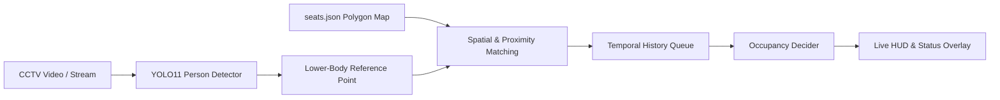

# Café Seat Occupancy Detection

[](https://www.python.org/)
[](https://docs.ultralytics.com/)
[](https://opencv.org/)
[](https://pytorch.org/)
[]()

> Real-time café seat occupancy and availability monitoring system using CCTV footage, YOLO11 person detection, custom polygon seat mapping, and temporal smoothing.

---


---

## Project Notes & Disclaimer (Learning Project)

> *"This project was developed as a hands-on exploration and learning journey in Computer Vision and Deep Learning. The system is still in active development (Work in Progress) and not yet production-perfect.*  
> *There are known edge cases (e.g., severe inter-person occlusions, patrons moving chairs away from fixed positions, or extreme camera viewing angles) that are continuously being studied and improved. Feedback, suggestions, and discussions are very welcome!"*

---

## Overview

Monitoring seat availability in cafés and restaurants in real time traditionally requires dedicated hardware sensors (IoT) attached to each chair, which can be costly and difficult to maintain.

This project leverages existing CCTV surveillance footage through a software-based Computer Vision pipeline:
1. Detect patron positions using the lightweight **YOLO11 Nano** model.
2. Interactively map fixed seating zones using custom polygons.
3. Associate detected persons to seats using geometric scoring criteria (*person-to-seat association*).
4. Apply **temporal state smoothing** to eliminate flickering caused by brief movements or momentary occlusions.

---

## Key Features

- **Real-Time Person Detection:** Powered by YOLO11n for fast, low-latency detection of the `person` class (COCO class 0).
- **Interactive Seat Mapping Tool (`map_seats.py`):** Visual GUI to manually annotate seat polygon boundaries directly on a CCTV frame, saved into `seats.json`.
- **Smart Association Algorithm (`occupancy.py`):**
  - Uses a lower-body reference point (~65% of the bounding box height, representing hips/torso) rather than the center or feet.
  - Multi-factor evaluation: point-in-polygon containment, proximity to seat centroid/anchor, and model confidence score.
  - One-to-one matching to ensure a single person cannot occupy multiple seats at once.
- **Temporal Smoothing & State Memory:**
  - Rolling deque history buffer (default 8 frames) to filter out temporary detection drops and false negatives.
  - Robust 3-state system: `AVAILABLE` (Empty), `OCCUPIED` (Taken), and `UNKNOWN` (Camera occluded / insufficient evidence).
- **Live On-Screen Analytics Dashboard:** Real-time HUD displaying total seats, occupied count, available count, and unknown count.
- **Interactive Debug Mode:** Press **`D`** to visualize person-to-seat association lines, detection IDs, and match confidence scores.
- **Unit-Tested Core Logic (`test_occupancy.py`):** Includes 9 comprehensive unit tests validating geometric matching, occlusion handling, and ambiguous states.

---

## System Pipeline



1. **Input:** CCTV video stream is read frame-by-frame.
2. **Inference:** YOLO detects people in the scene.
3. **Geometry Calculation:** Lower-torso coordinates are extracted and matched against seat polygons loaded from `seats.json`.
4. **Debouncing:** Seat states are recorded into a temporal history queue. Status transitions only occur when evidence is consistent across frames (`occupied_threshold` / `available_threshold`).
5. **Rendering:** Output is drawn with color-coded polygons (Green = Available, Red = Occupied, Orange = Unknown) alongside the live dashboard.

---

## Directory Structure

```text
cafe-seat-occupancy-detection/
├── main.py              # Main script for real-time detection & dashboard overlay
├── map_seats.py         # GUI tool to map and calibrate seat polygon coordinates
├── occupancy.py         # Core module: geometry calculation, matching, and temporal smoothing
├── test_occupancy.py    # Unit tests for the occupancy matching module
├── seats.json           # Seat polygon coordinate data (mapping output)
├── yolo11n.pt           # YOLO11 Nano model weights
├── CCTV FOOTAGE.mp4     # Sample CCTV video footage for demo
├── frame_preview.jpg    # Visual demonstration preview
├── requirements.txt     # Python project dependencies
└── README.md            # Project documentation
```

---

## Getting Started (Quick Start)

### 1. Prerequisites
- Python 3.10 or higher
- Git

### 2. Clone Repository
```bash
git clone https://github.com/yurawawawawa/cafe-seat-occupancy-detection.git
cd cafe-seat-occupancy-detection
```

### 3. Set Up Virtual Environment & Install Dependencies
```bash
# Create virtual environment
python -m venv .venv

# Activate virtual environment
# Windows (PowerShell):
.\.venv\Scripts\Activate.ps1
# Linux / macOS:
source .venv/bin/activate

# Install dependencies
pip install -r requirements.txt
```

### 4. (Optional) Map New Seats
If you want to use your own CCTV video or camera feed:
```bash
python map_seats.py
```
- **Left Click:** Mark seat corner points (minimum 3-4 points per seat).
- **ENTER / SPACE:** Save current seat polygon.
- **U:** Undo the last placed point.
- **R:** Reset points for the seat currently being drawn.
- **Q / ESC:** Finish and save coordinates to `seats.json`.

### 5. Run Occupancy Detection
```bash
python main.py
```
- Press **`D`**: Toggle **DEBUG** mode (shows association vectors and scores).
- Press **`Q`**: Quit the application.

### 6. Run Unit Tests
```bash
python -m unittest test_occupancy.py
```

---

## Configuration Parameters

All thresholds can be adjusted via `MatchingConfig` in [`occupancy.py`](occupancy.py):

| Parameter | Default | Description |
|-----------|---------|-------------|
| `min_match_score` | `0.50` | Minimum score required to assign a person to a seat |
| `ambiguity_score` | `0.35` | Score threshold above which a candidate match is considered ambiguous |
| `reliable_detection_conf` | `0.25` | Minimum confidence score for a YOLO detection to be considered reliable |
| `history_size` | `8` | Size of temporal rolling deque buffer used for smoothing |
| `occupied_threshold` | `0.60` | Proportion of positive frames in buffer required to classify a seat as `OCCUPIED` |
| `available_threshold` | `0.20` | Proportion of negative frames in buffer required to classify a seat as `AVAILABLE` |

---

## Current Limitations & Roadmap

As this is an exploratory learning project, several limitations exist and provide directions for future iterations:

- [ ] **Dynamic Seat Displacement:** Currently assumes static/fixed seats. If patrons move chairs significantly, accuracy degrades.
- [ ] **Severe Occlusion:** Low camera angles can lead to misassociation when a standing patron occludes a seated person behind them.
- [ ] **Multi-Camera Support:** Fusing multiple camera perspectives to cover blind spots across the venue.
- [ ] **Web Dashboard / IoT Integration:** Exposing seat availability via REST API / Webhooks (FastAPI/Flask) or a Telegram bot for public customer access.

---

## Contributing & Feedback

Feedback and suggestions are highly appreciated! To contribute:
1. Fork the repository
2. Create your feature branch (`git checkout -b feature/your-feature-name`)
3. Commit your changes (`git commit -m 'Add some feature'`)
4. Push to the branch (`git push origin feature/your-feature-name`)
5. Open a Pull Request

---

## License

Distributed under the MIT License. Feel free to use, study, and build upon this project for educational and commercial purposes.
